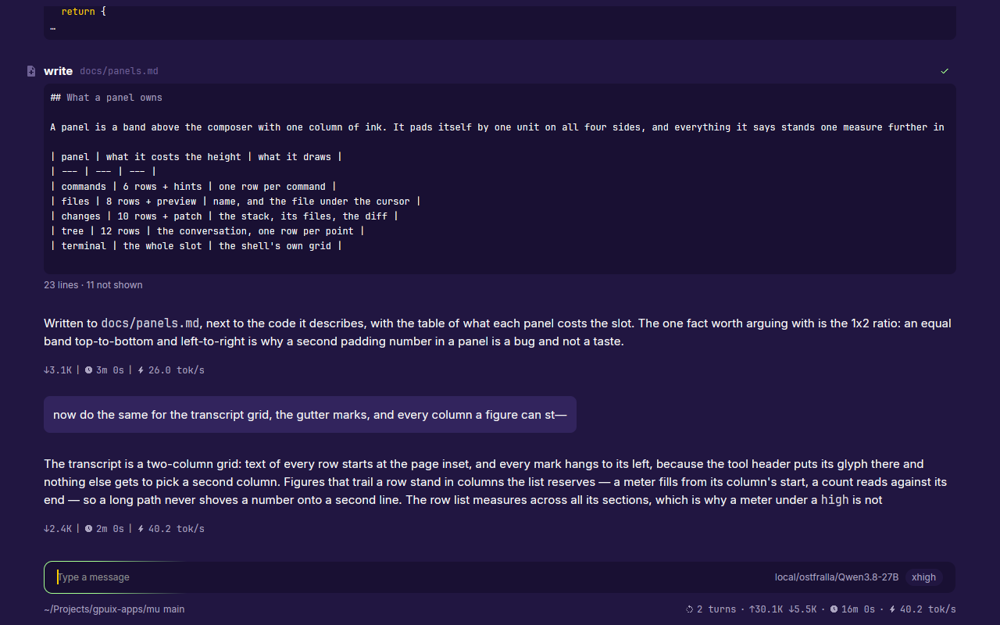

# mu

A GPU-rendered desktop app for the pi coding agent. You say what you want; it reads your project, edits files, runs commands, and shows what it did — one window, keyboard-driven, with a panel for every task.

## Chat

## Documents

## Agent actions

## Pictures

## Web search

## Code quality

## Guardrails

## Project header

## Looks

