# mu

mu is a native GPU-rendered desktop app for the pi coding agent. You type what you want; the agent reads your project, edits files, runs commands, and shows what it did. The name comes from the Greek letter [mu](<https://en.wikipedia.org/wiki/Mu_(letter)>) (Μ, μ), the twelfth letter of the Greek alphabet.

The composer works like Raycast: a keystroke opens a panel above it, you type to filter a list, Enter applies, Esc closes. The whole app is keyboard-driven; shortcuts are printed in the bar under every panel.

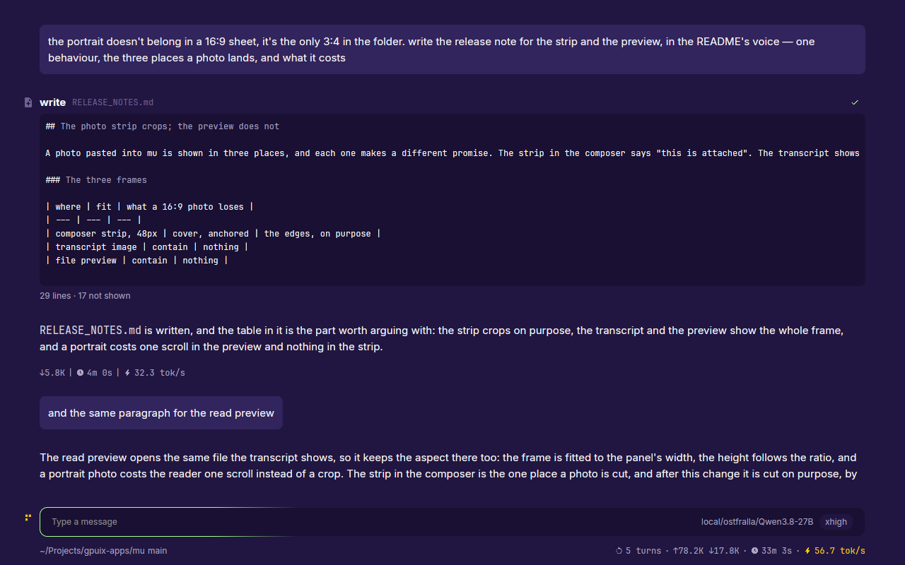

_One window, one conversation: your prompt, what the agent ran, what it read, what it changed, the answer, its reasoning, and what the run cost. The bar at the bottom of the window keeps the project, the model, the turns, the tokens, the time, the speed, and the cost in view while you work._

---

Every screen below is shown as it looks in a real window, with a session in it.

| Feature        | What you see                                                                                   |
| -------------- | ---------------------------------------------------------------------------------------------- |
| Chat           | a whole session: photos pasted, the photos read, a note written, the answer arriving           |
| Agent actions  | commands running, passing, failing; a read; a write arriving line by line; a diff; long output |
| Questions      | the agent stops mid-run and asks you, in the composer slot                                     |
| Composer       | a draft typed, two photos attached above it, the command panel open                            |
| Paths          | `~/` typed in the draft, Tab, the folder's names listed with a preview of the highlighted one  |
| Models         | the model list in the middle of a session, five models, the current one ticked                 |
| Models         | the thinking levels, the current one ticked                                                    |
| Sessions       | the project's saved sessions, every one of them, one previewed                                 |
| History        | the conversation as a tree, the cursor on a side branch                                        |
| Changes        | the project's history, the files of a change, its diff                                         |
| Changes        | a split asked of the agent, the diff it read, the two changes it made                          |
| Web search     | a search, the pages it read, a search that got nothing                                         |
| Code quality   | what the project says about itself: thresholds, unused code, clones, a change's reach          |
| Generative UI  | an answer that is a working screen: a filter picked, a stepper moved, one press waiting        |
| Figures        | numbers plotted in the log: bars over a year, their axis and peak read back, a value refused  |
| Structures     | a folder tree and a cost table drawn in the log, its columns added up, a row refused for not fitting |
| Guardrails     | a command stopped before it ran, the panel of rules that stopped it                            |
| Guardrails     | the rules tested, the cases written, the coverage read                                         |
| Status bar     | the counts of one answer and of the whole conversation                                         |
| Project header | the moment you open mu on a project                                                            |
| Looks          | the same session in each theme, and the nine accent colours                                    |

## Chat

Type a message, press Enter. The answer arrives in place, word by word, and stays: the log keeps your prompt, everything the agent did, and what it said.

Answers read as documents — headings, lists, tables, code you can copy, links you can open. The agent's reasoning sits beside its answer, openable when the change is risky and folded away when it is not. A run in progress can be stopped with Esc, and the half-finished answer stays where it stopped.

Pasted screenshots go into the conversation and the agent looks at them; the picture is in the log, so you know what it saw.

## Agent actions

Every command, file read, and file edit is a line in the log, in the order it happened: running, passed, failed. Failed lines are marked in red and keep their error under them, so the failure sits right where the agent's next move begins.

A line opens the moment the model opens the call, not when the tool finishes, and it grows with the arguments as they stream. A write is the clearest case: the file is painted as it is written, code-highlighted, and while the call is still streaming the panel shows the newest lines rather than the first, so it scrolls as the pen moves; once the write lands it reads from the top again. The row says how many lines have landed — no "successfully wrote" note about something you watched happen. A read shows the slice of the file it took; an edit shows the diff it made. Long output scrolls where it is and never pushes your conversation off screen. You can always see what the agent knew, and what it changed, before you trust it.

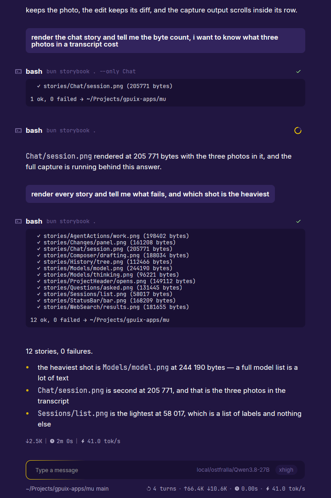

## Questions

When the job has a fork in it, the agent stops and asks, in the place you type: the question, why it is asking, the options numbered, and what the highlighted one means. Some questions take several answers, some take your own words, some are a yes or no before the irreversible step.

Nothing runs while it waits on you, and the bar at the bottom of the window says which question of how many you are on while it does. What it asked and what you chose stay in the log, so the reason behind the work is readable later.

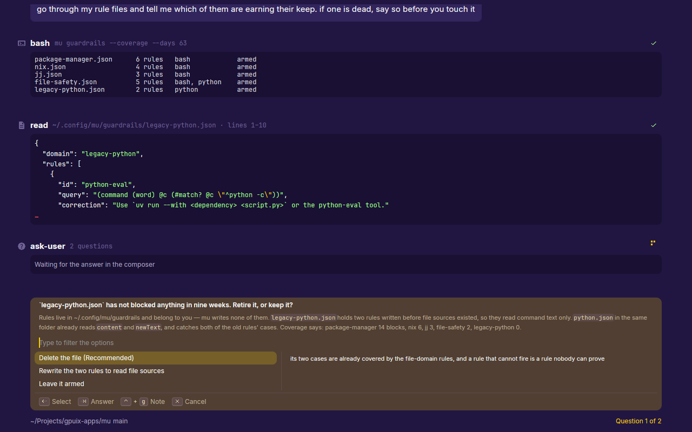

## Composer

The composer is how you talk to the agent and how you drive the app. The card grows with the draft, keeps the attachments you pasted above it, and while the draft is still blank it carries the active model, the thinking level, and how full the conversation is as pills. Start typing and the pills step out — the question is asked, and the row is yours.

A keystroke opens a panel above it: every command (`Ctrl+Shift+P`), the files of the project (`Ctrl+P`), your own past prompts (`Ctrl+R`), the model (`Ctrl+L`), the thinking level (`Ctrl+T`), the sessions (`Ctrl+H`), the conversation tree (`Ctrl+Shift+T`), the project's changes (`Ctrl+K`), the repo's operation log (`Ctrl+O`). You type to narrow the list, Enter applies, Esc closes, and the keys that do it are printed under the panel. Tab is the keystroke that completes a path you are typing in the draft, and [Paths](#paths) is that story.

How full the conversation is shows on the composer's own border: it runs along the edge, turns orange, then red.

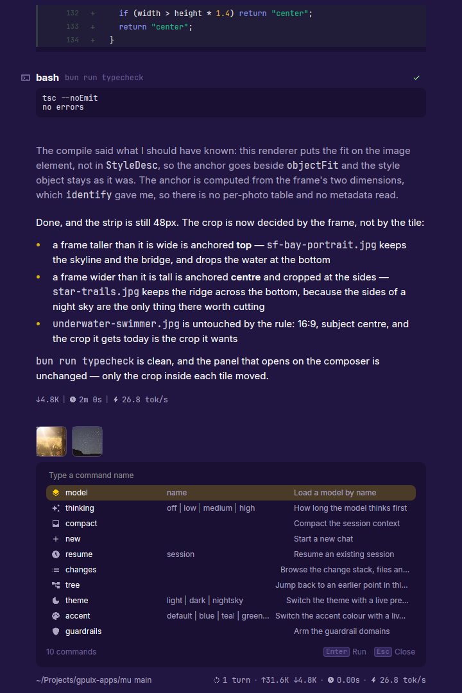

## Paths

Type a path in the draft — `~/`, `./src/`, `../notes/`, an absolute path, an `@` mention — and press Tab: a panel opens over the draft with that folder's names, directories first with a slash on the end, and the list narrows as you keep typing. Tab takes the highlighted name: a folder keeps the panel open so you go a level deeper with the next Tab, and a file writes the path, adds the space, and closes the panel. Enter takes the highlighted name too: the panel is the draft in another shape, but a panel is a choice and never a send, so completion cannot put a message in the conversation. Escape closes the suggestions and leaves every character you typed in the draft, and Enter there sends what you have. The highlighted name is read, so the panel puts the file open beside the list and you complete to the file you mean. Tab in ordinary prose does nothing, because there is nothing to complete there, and a URL is left alone.

`Ctrl+P` is the other half: it searches the whole project by name and inserts what you pick, while Tab completes the path your hands are already typing.

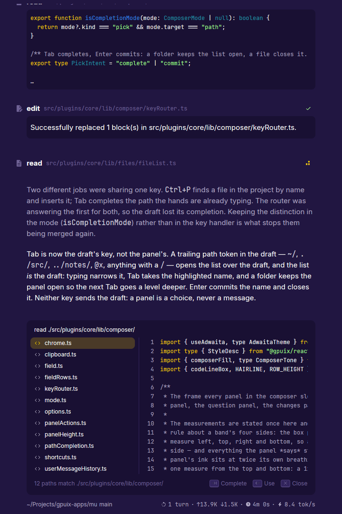

## Models

You pick the model from a searchable list and set the thinking level, in the middle of a session, and the change applies the moment you choose. Long lists narrow as you type and page by the cursor, with the match count under the panel.

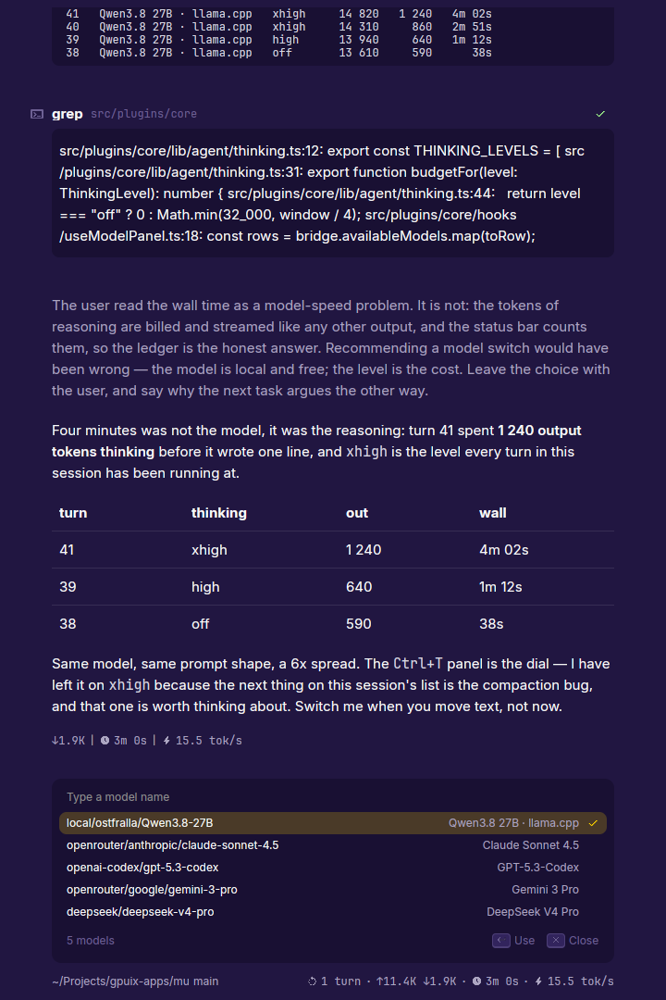

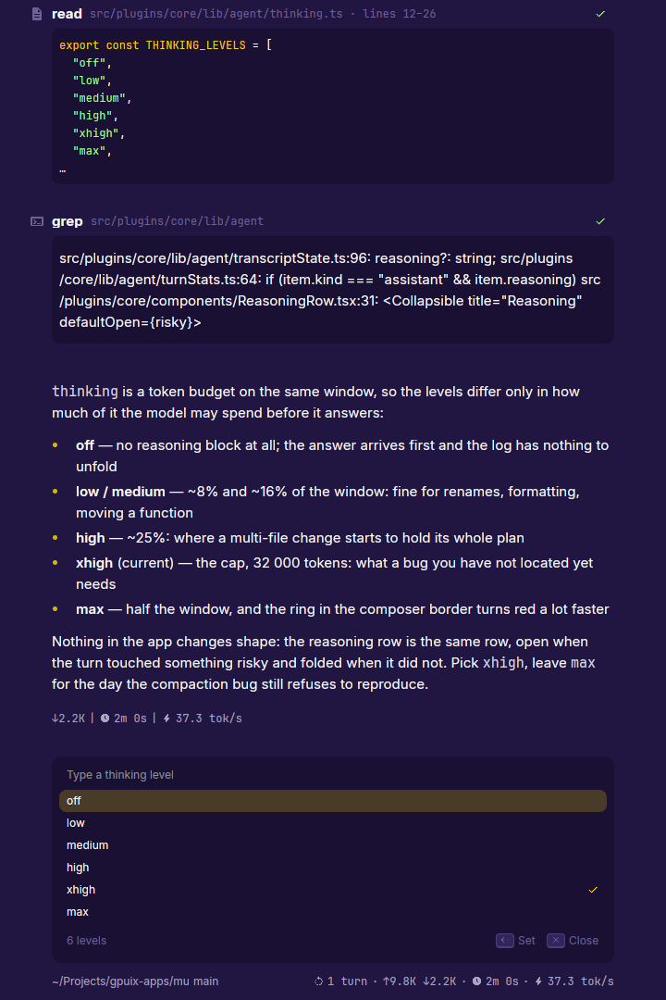

## Sessions

Sessions are saved per project. Open the list to see each one on a single line — its label, which is its name when it has one and the first line of its opening message otherwise — with two figures beside it: how long the session ran, and how old it is. Arrow over it to read the conversation before you open it; type to narrow it, with the match count in the bar under the panel; delete one, and undo it from the bar that says so.

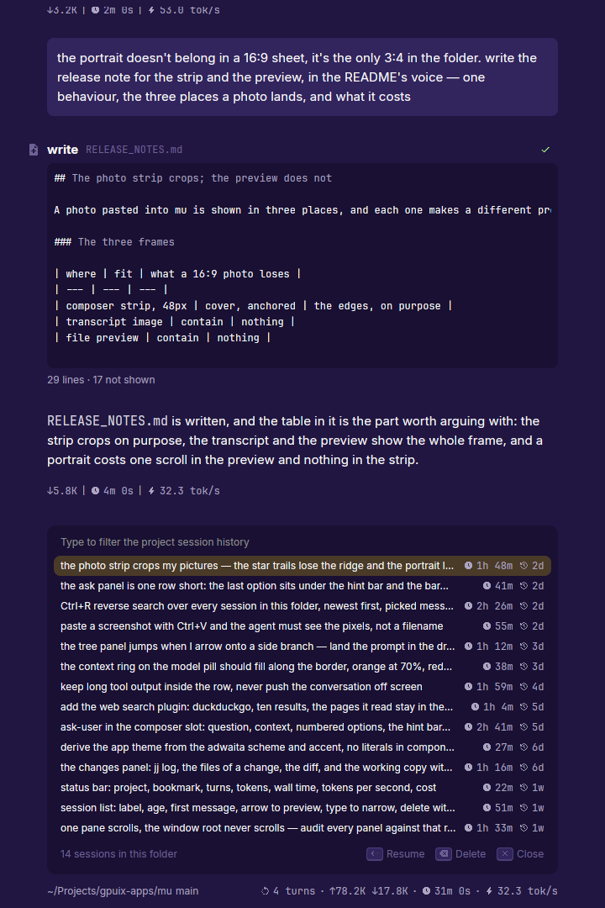

## History

A conversation is a tree, not a line. Open the history to see every point you have been at — your prompts, the agent's calls, labels, compactions, and the branches off them. Jump to a point and the conversation rewinds to it; the branch you left stays in the tree. Filter it by what was said.

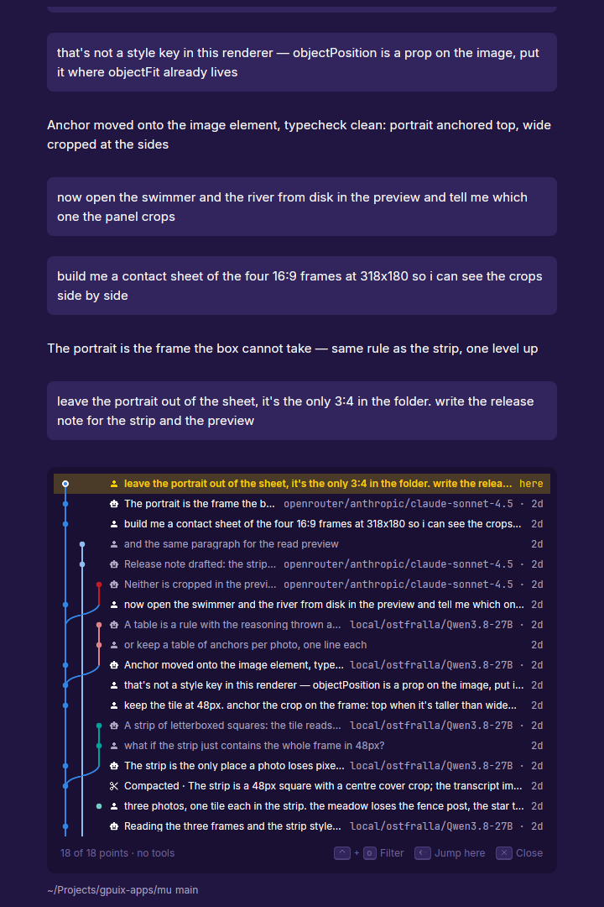

## Changes

The agent's work is your project's history. The changes panel shows the stack of changes on the left, the files of the selected change on the right, and under them the file you are on, drawn as what it is. Source is a real diff — its lines tinted in and out, with the words that changed marked inside a paired line. A csv, tsv or tab file is its two tables lined up row by row, with the cells that changed marked. A picture is the picture before and the picture after, because no patch says what changed in an image. Space checks changes, so one ask can cover several of them.

Naming a change and splitting it are asked of the agent. Press describe, or split on the change or on one of its files, or split hunks, and the panel hands over the change, the files and the hunks you named: the agent reads the diff, writes the message itself, makes the write, and leaves a row in the log with the change ids it ended up with and which half holds what, so you can check it against the history it came from.

Squash, revert, drop, bookmark and push happen in the panel.

jj keeps a log of every change it has made to the repo, and `Ctrl+O` opens it: the operations on the left, the files the selected operation moved on the right, and its patch under them. So a mistake is readable before it is undone — stand on the operation you want back and read what it did, then restore to it. Undo and redo are jj's own, and the panel re-reads every list afterwards, because an operation moves the whole workspace rather than one change.

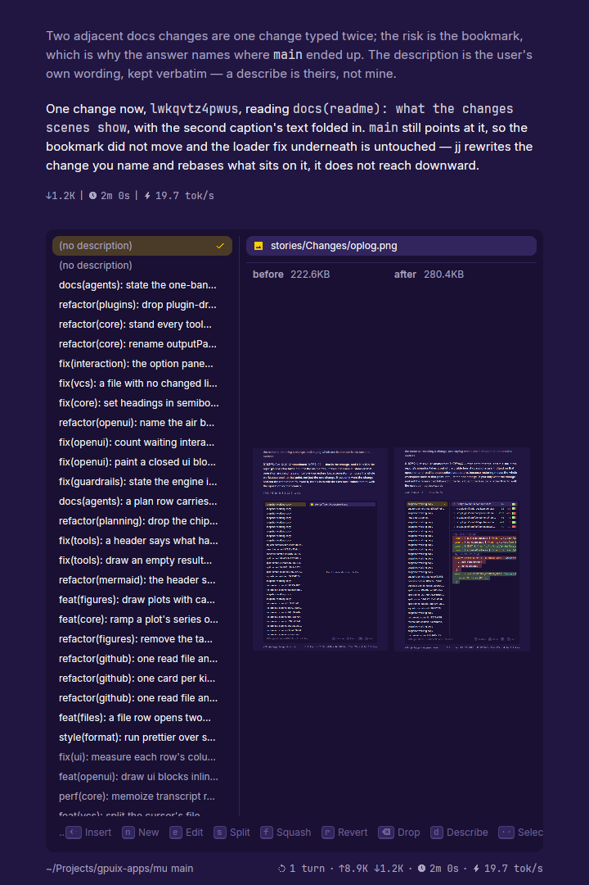

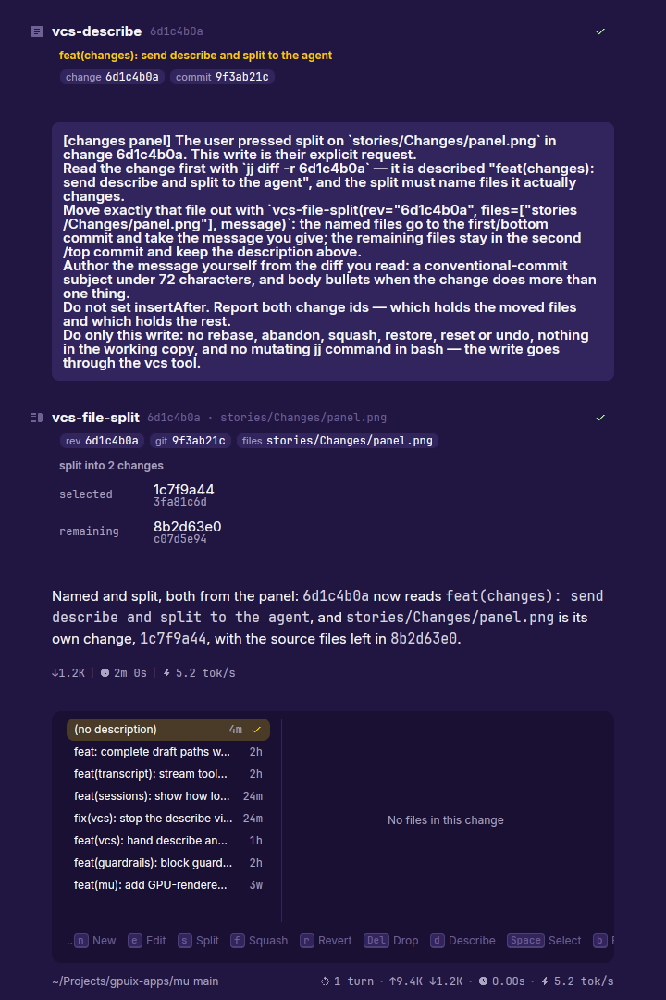

## Web search

When the agent needs something your project does not know, it searches the web, and you watch it search. The pages it found are in the log with the answer they produced, so you can check its sources; a search that got nothing is shown as got nothing.

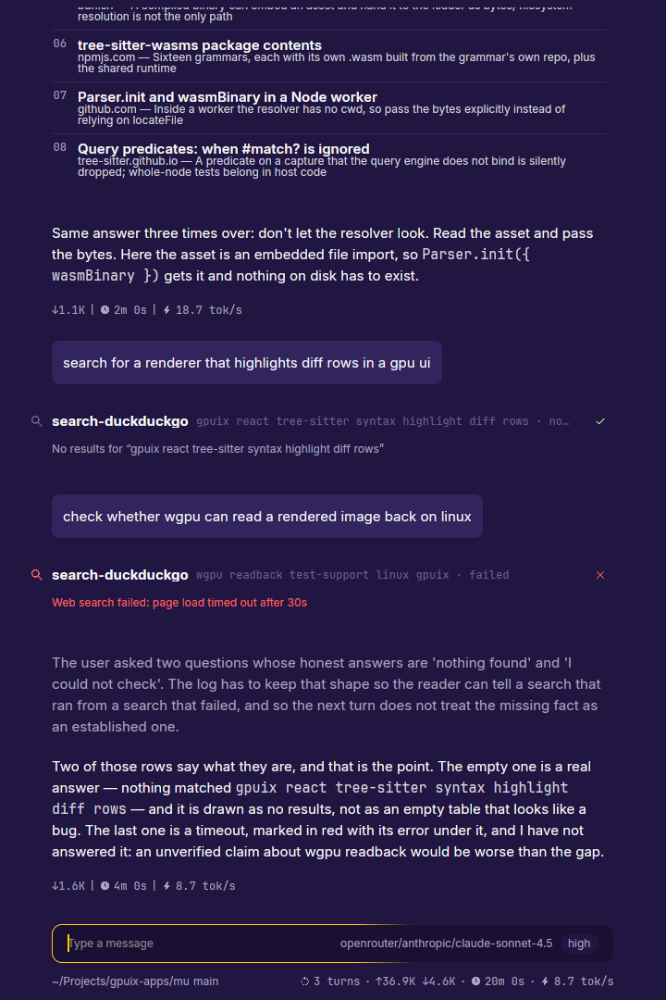

## Code quality

Before the agent changes a file it did not write, it asks the project about itself: what sits over the complexity thresholds, what nothing imports, what is copy-pasted, and how far one commit reaches. `code-complexity`, `code-dead-code`, `code-duplicates`, `code-review`, `code-symbol-inspect` and `code-symbol-references` answer in rows the log draws — chips for what was read, a meter showing how a finding ranks against its own run, clone groups listed with every place they appear — and every read is bounded, so surveying a large tree stays a survey instead of a wall of text. Nothing is fixed behind the agent's back: an unused export it found is a row, and deleting it is your call.

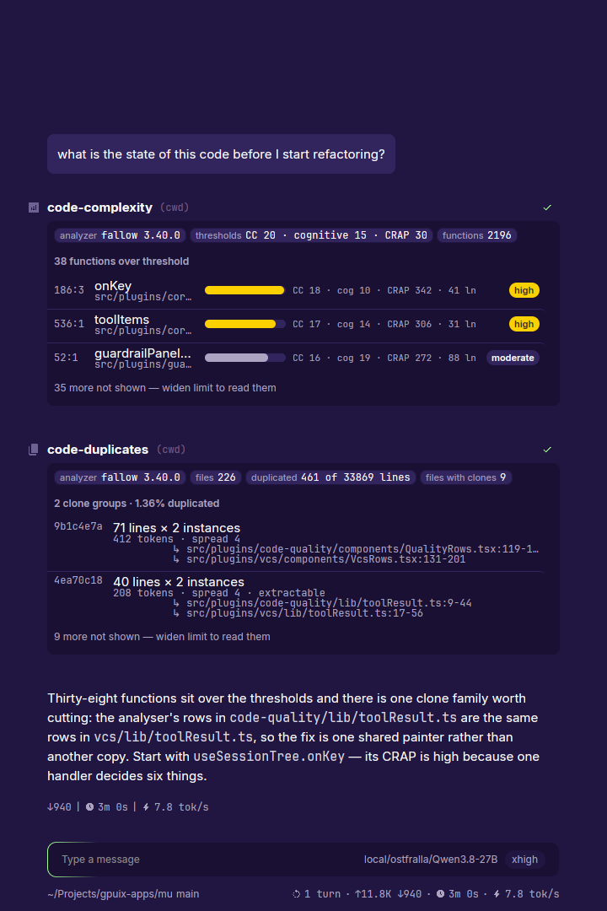

## Generative UI

Sometimes the answer is a screen. The agent writes a program in [OpenUI Lang](https://openui.com) and mu draws it in the log — a header, the thing you operate, a status line — from a library of components the app itself owns: `Screen`, `Header`, `Pane`, `Table`, `Choice`, `Stepper`, `Slider`, `Field`, `Button`, and the rest, all rendered by `adwaita-gpuix` with no DOM anywhere.

The program is not a picture of a form. It keeps its own state: the filter, the stepper and the slider write `$variables` the rest of the screen reads, so picking a filter hides rows without another message. What it needs from outside comes as data the agent serves it — `openui-tools` decides what a `Query(name, …)` resolves to, and a name nothing served fails in the open, reported to the program rather than answered with an empty table. What you do with the screen is queued: every press, pick and drag waits, and `openui-events` hands it to the agent once.

The program lives in the log, not in the call that wrote it: `openui-render` opens it, `openui-stream` grows it piece by piece while you watch, and every later call edits the same screen in place. `openui-state` says what actually drew, `openui-library` says what may be named at all, `openui-validate` checks a program before it is committed, and `openui-list`, `openui-switch` and `openui-clear` say what is in the log and what is showing. A resumed session keeps its rows and loses its screens, and the row says so instead of inventing one.

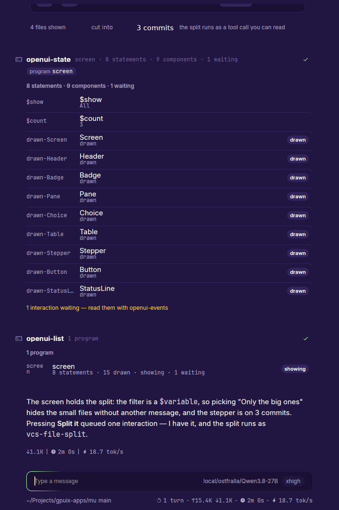

## Figures

Sometimes the answer is a set of numbers and its shape. `chart-render` takes the points and plots them in the log: bars across a category axis, or a line with markers and a fill, one series or several with a legend that names them. What travels in the row is the data of the plot, never a bitmap, so the picture wears whatever theme the window is wearing and a session resumed next month still draws it.

The model cannot see the picture, so its answer is a reading of it: how many points were plotted, the span of the axis, the range, the total, the mean, the peak, and the points themselves as figures. That is what makes a wrong plot catchable by something without eyes — a peak in the wrong month is a month plotted in the wrong order. A value that is not a number (`"1,234"` out of a spreadsheet) refuses the whole call and names the point the cell sat on, rather than drawing a bar that lies; past 64 points the call says how many were not plotted, because a plot that dense is a texture and the fix is to group them.

When the figure has to be operated — a filter that changes what is plotted, a picker, several figures on one screen — it is an OpenUI program instead. `chart-render` is for the plot that is the whole answer.

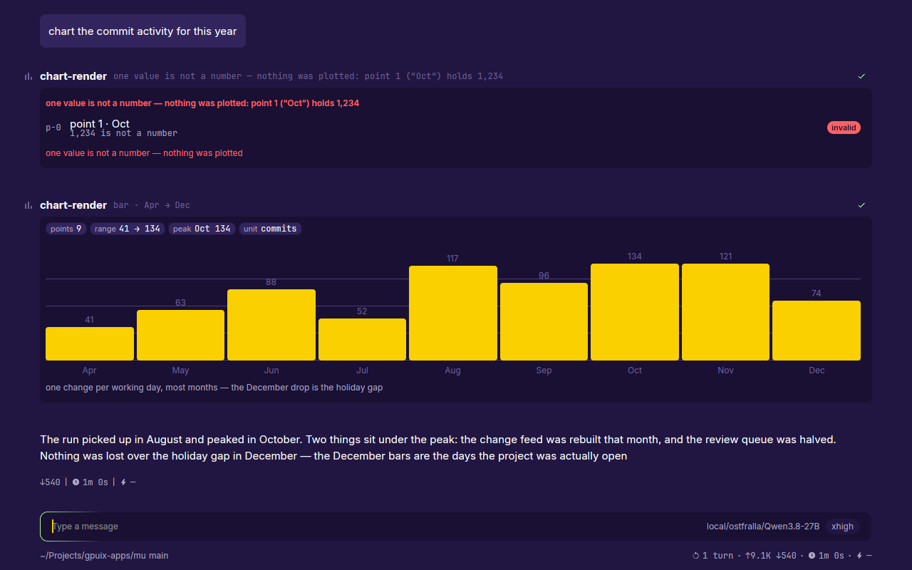

## Structures

Sometimes the answer is a shape. `tree-render` takes named things nested in groups and draws them in the log — a package's folders, a module graph, a call chain, a changeset — in the same rows the file tree wears, so its folders still open and close under the cursor, and when the nodes say what moved the `+N −M` columns line up across the whole tree. `table-render` takes a header and its rows: a row is a list of cells or an object keyed by the column names, and a column whose cells are all numbers is set in mono and stands on the right of its column, so the digits line up under the header.

Both answer in readings, because the model has no eyes either. The tree comes back as indented text with its counts and its depth, so a leaf that ended up one level too deep is visible as a nesting mistake; the table comes back as an aligned table with what each figure column sums to and ranges between. A node with no name refuses the call and names the path it hangs under; a row wider than the header, or an object with a key no column names, refuses it and names the cell that had nowhere to stand. Past 80 nodes, or ten levels, or 60 rows, the answer says what was not drawn — a tree that dense is a listing, and the fix is to draw the part that carries the point.

## Diagrams

Some explanations are a picture. `mermaid-render` takes Mermaid source and draws it in the log: flowcharts, sequence, state and class diagrams, ER, gantt, pie, git graphs, mindmaps, C4, timelines, kanban. The picture is painted from the SVG the engine produced, in the colours the window is currently wearing, with no card behind it — the ink stands on the log's own page, the way the prose around it does — and it is scaled to the log rather than to the diagram's own canvas — so `path` also writes the `.svg` next to your project, which is the full-size one you can commit or open.

The model cannot see the picture, so its answer is a reading of it: the kind that came out, the canvas it was laid out on, how long it took, and every label the diagram says. That is what makes a wrong diagram visible to something without eyes — a label that is missing is a node that was never parsed. A source the parser refuses answers with its code, its line, its column and the line it stopped on, which is a fixable thing; the row shows the same snippet with its caret.

The engine is [Pele](https://pele.run), the renderer Obsidian ships: pure JavaScript, no browser, no DOM, no PNG rasteriser — it measures text from its own metrics, so a diagram is drawn in the same process as the conversation it explains.

## Guardrails

Some commands are not what a project wants: a global install, a `sleep` standing in for a real condition, a `rm` where `trash` exists. Guardrails read a tool call as a syntax tree rather than a string, and a call that matches never runs — the agent is handed the correction to take instead, in the result, so the next move is the right one.

`/guardrails` (Ctrl+Shift+G) opens the panel: one line per rule file — the domain, how many rules it holds, the grammars those rules read, and the tick that says the domain is armed. A domain is the smallest thing that can be armed: a rule is a line in a file you own, not a switch. Enter arms or disarms a domain without moving the cursor, and the status line counts the domains that are armed, the rule files that were read, and says how long the parser took to boot, so an engine that is not reading is never silent. A command the engine cannot read is let through: a guardrail that cannot be read blocks nothing.

A guardrail is a file you own. Rules live in mu's own directory under your config — `~/.config/mu/guardrails/package-manager.json`, `nix.json`, `jj.json` — and the cases that prove each rule sit beside it as `package-manager.fixtures.json`. Nothing is written into your project, nothing is inherited from another program's settings, and mu remembers which domains you disarmed, so a domain you turned off stays off. A rule is a query, a domain, and the correction the agent is handed instead of the command.

Guardrails are tended from inside the session, by the agent itself. `guardrails-test` runs a domain's fixture suite — the commands a rule exists to stop, and the ones that only read alike — against the live engine and prints PASS/FAIL per case. `guardrails-fixture-update` grows that suite as rules change, because a rule with no false-positive case is a rule that has never been asked not to fire. `guardrails-coverage` reads saved sessions and says which domains blocked this week and which have gone quiet. Arming is not one of their jobs: the panel's switches are the only way a domain goes quiet, and they answer to the user, not to the session.

_The engine, the panel, the block path and these tools are in place, and rules are read from your own config at startup; no rule set ships with mu, so on a fresh machine the list is empty, every suite is unwritten, and every guarded call is read and released._

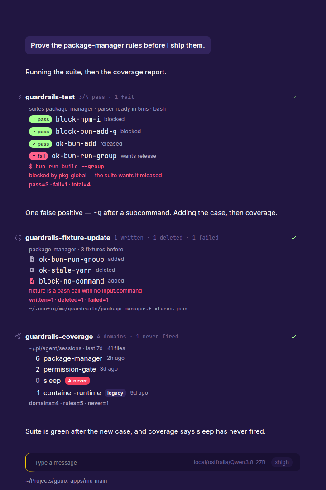

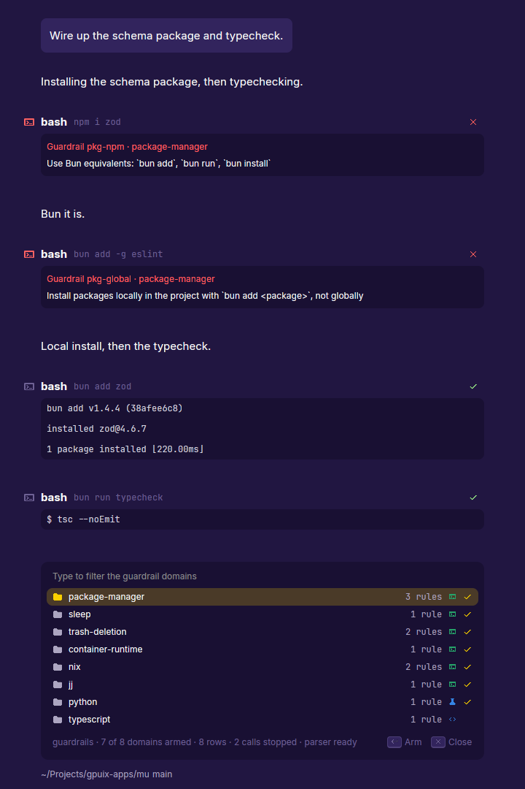

## Status bar

The bar at the bottom of the window keeps the project, the bookmark, the model, and the thinking level in view, and under the last answer of each turn sit that answer's tokens, seconds, and speed. The line closing the log totals the whole conversation, so you always know what a job cost. While the agent waits on an answer, the counts give their place to the question's progress.

## Project header

Open mu on a project and the top of the window tells you where you stand: the branch, what the repository has been doing over the year, and the prompts people keep starting with, which seed the composer in one keystroke. It also says when a folder is not a repository.

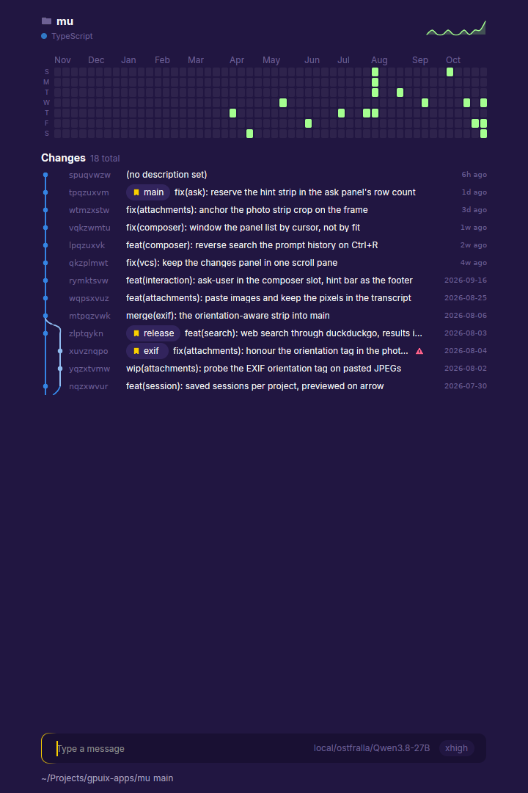

## Looks

Three themes (Light, Dark, Nightsky) and nine accent colours, picked from the composer panels (`Ctrl+,` and `Ctrl+Shift+,`), previewed live as you arrow through the list, and saved. Multiple windows can be open on the same project, each on its own session.

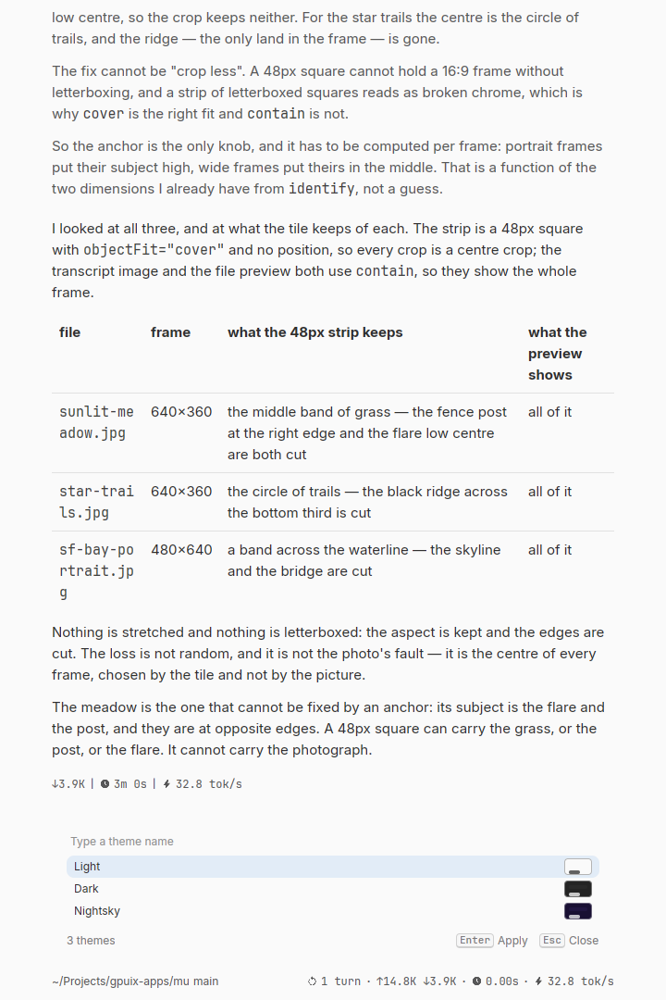

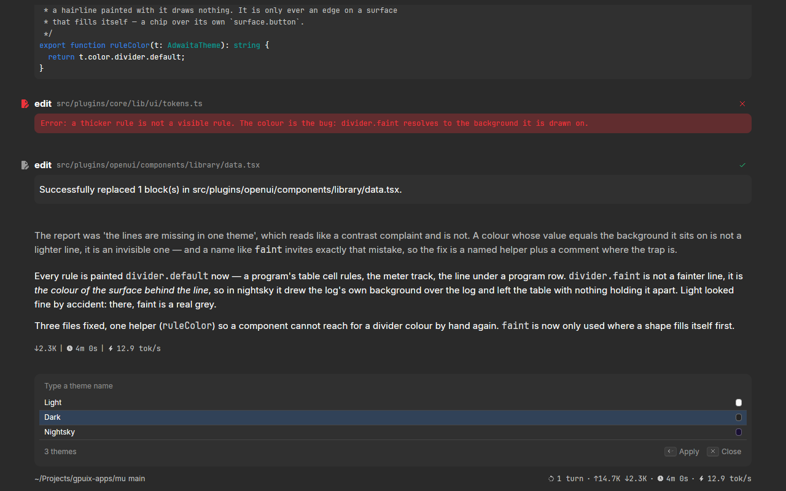

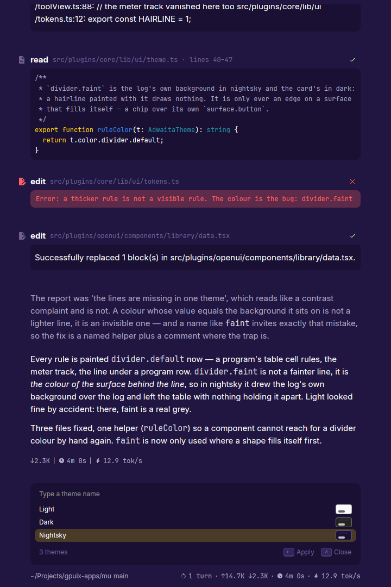

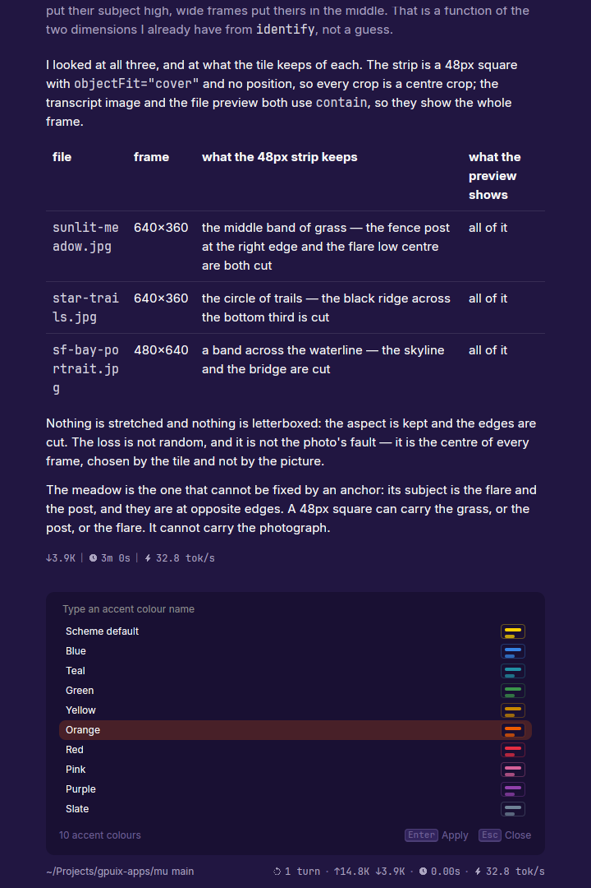

---

## Keyboard

| Keys                           | Action                             |
| ------------------------------ | ---------------------------------- |
| `Enter`                        | Send                               |
| `Alt` + `Enter`                | New line                           |
| `Tab`                          | Autocomplete                       |
| `Ctrl` + `Shift` + `P`         | Commands                           |
| `Ctrl` + `L`                   | Models                             |
| `Ctrl` + `T`                   | Thinking level                     |
| `Ctrl` + `P`                   | Files                              |
| `Ctrl` + `H`                   | Session history (resume, delete)   |
| `Ctrl` + `R`                   | Search your past messages          |
| `Ctrl` + `K`                   | Project changes                    |
| `Ctrl` + `Shift` + `T`         | Conversation tree                  |
| `Ctrl` + `,`                   | Theme                              |
| `Ctrl` + `Shift` + `,`         | Accent color                       |
| `Ctrl` + `V`                   | Paste image                        |
| `Ctrl` + `C`                   | Clear draft and attachments        |
| `Ctrl` + `N`                   | New session                        |
| `Ctrl` + `Shift` + `N`         | New window                         |
| `Ctrl` + `PageUp` / `PageDown` | Previous / next conversation point |
| `Ctrl` + `Home` / `End`        | Start / end of the conversation    |
| `Ctrl` + `U`                   | Delete to line start               |
| `Ctrl` + `W`                   | Delete word                        |
| `Ctrl` + `A` / `Ctrl` + `E`    | Line start / line end              |
| `Ctrl` + `]`                   | Jump to character                  |
| `Space`                        | Cycle a setting value              |
| `Esc`                          | Close panel                        |
